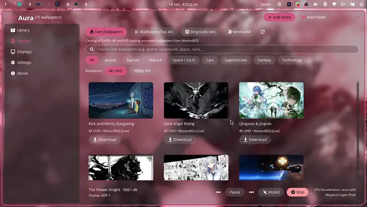

<div align="center">


# Aura

### The definitive live wallpaper engine for COSMIC Desktop.

**Transform your COSMIC and Wayland workspace (including Niri, Hyprland and Sway) with fluid animated backgrounds, dynamic desktop color matching, and zero lag when gaming. GNOME and KDE Plasma backends are experimental.**

[](https://github.com/antwny/aura/releases/latest)
[](https://github.com/antwny/aura/actions/workflows/ci.yml)
[](LICENSE)

[Download](https://github.com/antwny/aura/releases/latest) · [Changelog](CHANGELOG.md) · [Report an issue](https://github.com/antwny/aura/issues)

</div>

## Quick Install (One Command)

```bash
curl -fsSL https://raw.githubusercontent.com/antwny/aura/main/install.sh | bash
```

Linux x86_64. Installs to `~/.local` by default. See [requirements and other install options](#install).

<div align="center">

<a href="https://antwny.github.io/aura/assets/video/aura-showcase.mp4">
  
</a>

<sub>Click the preview to watch the demo.</sub>

</div>

## What Aura does

- **Organizes wallpapers:** Add local videos and images, mark favorites, assign a wallpaper to each display, and rotate a filtered selection on a schedule.
- **Finds new backgrounds:** Browse and download from the online catalogs in Explore. Results appear as each source responds.
- **Controls playback:** Pause manually or automatically when windows cover the desktop, a fullscreen app is active, or the device is on battery. Available controls depend on the desktop backend.
- **Manages wallpaper audio:** Adjust volume or mute from Aura and the tray. An optional setting mutes the wallpaper while an MPRIS media player is playing, then restores the chosen audio preference.
- **Matches the desktop:** Extract colors from the current wallpaper for Aura and, on COSMIC, the system accent.
- **Offers a quick switcher:** Open the wallpaper picker with `aura switcher`; choose between Classic, Cinematic, and Honeycomb layouts.
- **Adds optional effects:** Cursor-driven depth and audio-reactive effects use the included helper binaries when supported.
- **Updates in the app:** Aura checks for releases and shows download progress when an update is installed.

## Desktop compatibility

| Desktop | Wallpapers | Notes |
| --- | --- | --- |
| COSMIC and compatible Wayland layer-shell compositors | Static images and videos | Uses `mpvpaper` for the wallpaper layer. Includes support for Niri, Hyprland, and Sway. |
| GNOME on Wayland | Static images and videos | Experimental. Images use GSettings; videos require the [Hanabi extension](https://github.com/jeffshee/gnome-ext-hanabi). |
| KDE Plasma | Static images and videos | Experimental. Images use Plasma's native wallpaper API; videos require [Smart Video Wallpaper Reborn](https://github.com/luisbocanegra/plasma-smart-video-wallpaper-reborn). Without the plugin, Aura displays a still poster. |

Aura detects the desktop automatically. The backend can also be selected in Settings. The Static backend is available when video playback is not wanted.

## Install

The prebuilt release is for **Linux x86_64**. It includes Aura, `aura-effects`, `aura-depth`, and a precompiled `mpvpaper` 1.9 binary. Video playback still needs the relevant system libraries, and thumbnails need FFmpeg.

| Distribution | Video and thumbnail dependencies |
| --- | --- |
| Arch Linux / CachyOS | `sudo pacman -S --needed mpv ffmpeg` |
| Pop!_OS / Ubuntu / Debian | `sudo apt install libmpv2 ffmpeg` |
| Fedora | `sudo dnf install mpv-libs ffmpeg-free` |
| openSUSE | `sudo zypper install mpv ffmpeg` |

### Installer options

The [quick installer](#quick-install-one-command) downloads the latest release and installs Aura under `~/.local` by default. For a system-wide installation, run:

```bash
curl -fsSL https://raw.githubusercontent.com/antwny/aura/main/install.sh | bash -s -- --system
```

Review [install.sh](install.sh) before running a remote script if you prefer.

### Install from the archive

Download the Linux archive and its `.sha256` file from [Releases](https://github.com/antwny/aura/releases/latest), then extract the archive and run its installer:

The `.sha256` file contains the expected hash. Compare it with the output of `sha256sum aura-v1.12.0-x86_64-linux.tar.gz` before extracting.

```bash
tar -xzf aura-v1.12.0-x86_64-linux.tar.gz
cd aura-v1.12.0-x86_64-linux
./install.sh --user
```

Use `./install.sh --system` for a system-wide install. Replace `1.12.0` in the example with the version you downloaded.

### Build from source

Install a current Rust toolchain and the development packages listed in [CONTRIBUTING.md](CONTRIBUTING.md). Then run:

```bash
git clone https://github.com/antwny/aura.git
cd aura
cargo build --release --locked
just install
```

`just install` installs the app, helper binaries, desktop entry, and icons for the current user. For live wallpapers, it also installs `packaging/mpvpaper` when present or uses the system copy at `/usr/bin/mpvpaper`.

## Use Aura

Launch **Aura** from the application menu or run `aura`. Add a folder or select a file in the Library, then apply it to all displays or choose a specific display. Explore provides downloadable wallpapers; Settings contains playback, audio, appearance, and rotation options.

Aura does not assign global keyboard shortcuts on your behalf. You can bind these commands in your desktop's shortcut settings:

| Command | Action |
| --- | --- |
| `aura switcher` | Open the quick wallpaper switcher |
| `aura next` / `aura prev` | Move through the current rotation pool |
| `aura toggle-pause` | Pause or resume the wallpaper |
| `aura apply /path/to/wallpaper.mp4` | Apply a local file |
| `aura stop` | Stop the wallpaper |
| `aura status` | Show the current status |
| `aura check-update` / `aura update` | Check for or install a release update |
| `aura --help` | Show all available commands |

For automatic media muting, enable the option in **Settings → Engine → Performance**. It responds to media players that expose playback state through MPRIS on the session bus.

## Development and support

See [CONTRIBUTING.md](CONTRIBUTING.md) for build dependencies, tests, and contribution guidance. The main commands are `just check`, `just test`, `just lint`, and `just build`.

If something is not working, [open an issue](https://github.com/antwny/aura/issues) with your distribution, desktop environment, Aura version, and steps to reproduce it. The release history is in [CHANGELOG.md](CHANGELOG.md).

## Acknowledgments & License

Aura is free and open source software licensed under the [GNU General Public License v3.0 or later](LICENSE).

Inspirations and references: [Papyrus](https://github.com/PSGtatitos/papyrus) and [skwd-wall](https://github.com/liixini/skwd-wall).

- **Community:** [@antwny on YouTube](https://www.youtube.com/@antwny) and [@antw-ny on Reddit](https://www.reddit.com/user/antw-ny/).
- **Support:** Star [Aura on GitHub](https://github.com/antwny/aura) or [donate via PayPal](https://www.paypal.com/donate/?business=antwnyab@gmail.com&no_recurring=0&currency_code=USD).
